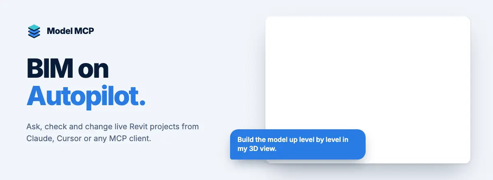

<h1 align="center">
  <picture>
    <source media="(prefers-color-scheme: dark)" srcset="docs/assets/hero-dark.webp">
    
  </picture>
</h1>

Model MCP for Autodesk® Revit® connects Claude Desktop, Claude Code or any MCP client that starts a stdio server to a live Revit project.
Ask questions about the model, check it, and change it in plain language.
Committed transactional model edits create one named Undo entry in Revit.
Read-only mode is one switch away.

[](https://github.com/sharafutdinovdi/revit-model-mcp/actions/workflows/ci.yml) [](https://github.com/sharafutdinovdi/revit-model-mcp/releases/latest) [](https://codecov.io/gh/sharafutdinovdi/revit-model-mcp) [](https://pypi.org/project/revit-model-mcp/)  [](https://scorecard.dev/viewer/?uri=github.com/sharafutdinovdi/revit-model-mcp) [](LICENSE)
<!-- best practices badge: add after the project id exists -->

## Install with an AI agent

On Windows, paste this prompt into Claude Code, Codex, Cursor, or another agent:
`Install Model MCP for Revit from https://github.com/sharafutdinovdi/revit-model-mcp. Follow docs/agent-install.md exactly.`
The [agent install guide](docs/agent-install.md) uses one release command with no checkout, Python, SDK, or administrator rights.

## Quick start

You need two parts: the add-in inside Revit on Windows, and the server next to your MCP client.
Details and requirements are in [requirements and installation](https://sharafutdinovdi.github.io/revit-model-mcp/install/).
Tested with Claude Desktop over SSH; other clients are listed on the [tested clients page](https://sharafutdinovdi.github.io/revit-model-mcp/tested-clients/).

**1. Install the add-in.**
On the Windows machine with Revit, download `RevitModelMcp-<version>-SingleUser.msi` (current user) or `RevitModelMcp-<version>-MultiUser.msi` (all users) from the [latest release](https://github.com/sharafutdinovdi/revit-model-mcp/releases/latest).
Install only one of them.
WinGet publication is pending.
The [submission](https://github.com/microsoft/winget-pkgs/pull/469197) is open, and the package is not yet in the catalog.
Use an MSI from the latest release until it is accepted.

Keep Revit closed during installation, then start Revit and open a model.
Revit asks whether to load the add-in, because release builds are not code-signed yet.

**2. Add the server to your MCP client.**
In Revit, Model MCP > Model MCP > Connect AI app registers the bundled server in Claude Desktop, Cursor, VS Code, or Codex (the ChatGPT app or codex CLI); Claude Code gets a copy-paste command.
The MSI includes the server executable, so this path needs no separate Python or uv installation.

If you prefer the PyPI server:
Install [uv](https://docs.astral.sh/uv/getting-started/installation/), then register the server.
For Claude Code on the same Windows machine:

```sh
claude mcp add revit-model-mcp -e REVIT_MCP_HOST=local -e REVIT_MCP_REDACT_PATHS=1 -- uvx revit-model-mcp
```

For Claude Desktop, open the `revit-model-mcp-<version>.mcpb` bundle from the latest release, or add this to its MCP configuration:

```json
{
  "mcpServers": {
    "revit-model-mcp": {
      "command": "uvx",
      "args": ["revit-model-mcp"],
      "env": {
        "REVIT_MCP_HOST": "local",
        "REVIT_MCP_REDACT_PATHS": "1"
      }
    }
  }
}
```

On macOS or Linux, use a [remote workstation](#remote-workstations) instead of `REVIT_MCP_HOST=local`.
The [Claude Desktop bundle](https://sharafutdinovdi.github.io/revit-model-mcp/install/#claude-desktop-bundle) page explains its settings form.

**3. Ask a first question.**
Restart the client, keep a model open in Revit and ask: "Call `revit_ping`, then tell me which model is open."
`success: true` means both parts are connected.
From a clone, `uv run --directory server revit-model-mcp` runs the same server without installing the package.

For updates, the release add-in checks GitHub daily and notifies by default; the PyPI server checks PyPI, or install the newer MSI ([updates](https://sharafutdinovdi.github.io/revit-model-mcp/updates/)).
Report bugs in [Issues](https://github.com/sharafutdinovdi/revit-model-mcp/issues/new/choose), ask questions in [Discussions](https://github.com/sharafutdinovdi/revit-model-mcp/discussions), and report vulnerabilities through [SECURITY.md](SECURITY.md).

## Why Model MCP

- **Model edit controls.** Transactional model edits create one named Undo entry, and one workstation lock enables read-only mode.
- **Confirmation first.** Saving, syncing and other irreversible steps wait for your explicit approval.
- **Installs like normal software.** MSI installers, with deployment guides for SCCM, Intune and Group Policy.
- **Works from a Mac.** MCP stdio runs through SSH to the Windows workstation, so no port opens.

## Features in 2.0

- **Model MCP ribbon tab.** The product menu contains About, Check for updates, and Settings.
  The panel provides Connect AI app, Activity, My tools, Read-only, Help, Report issue, and Support developer.
  After a channel permission refusal, Activity explains the problem.
  Model MCP > Repair channel permissions offers a confirmed repair of the reviewed folder permissions.
  See [channel permissions](docs/transport.md#channel-permissions).
  Update checks depend on the release channel.
  Buttons have contextual help and themed tooltips.
  See the [ribbon guide](docs/install.md#the-model-mcp-ribbon-tab).
- **Workstation read-only lock.** The ribbon and `revit_set_read_only` control one lock across running Revit versions for the Windows user.
  Chat unlock requires explicit confirmation.
  Machine policy remains enforced.
- **Model audits.** `revit_model_audit` checks one model against YAML, JSON, inline rules, or a builtin pack.
  Saved results support history comparisons.
  `revit_audit_report` produces XLSX and HTML reports.
  See [model audit](docs/model-audit.md).
- **Sheet inspection.** `revit_list_sheets` reads sheets, title blocks, revisions, placed views, and unplaced views.
- **Revit API lookup.** `revit_api_lookup` reads public types and members from the running Revit API before C# execution.
- **Progress notifications.** Clients that supply a progress token receive queue state, Revit API availability, and batch step counters during long requests.
  See [progress notifications](docs/transport.md#progress-notifications).
- **Document tab highlight.** A border marks the document handling MCP work and clears after completion.
  The [ribbon guide](docs/install.md#the-model-mcp-ribbon-tab) covers timing and settings.
- **Grouped C# authoring.** `revit_execute_code` and `revit_run_tool` accept `transaction="group"` for procedures that need their own transactions or edit scopes.
  The runner keeps the group within one Undo entry and rolls it back for dry runs or failures.
- **Reusable skills.** Coordinator, daily QA, sheet set, and ISO 19650 issue register workflows ship in the repository.
  See [prompts and skills](#prompts-and-skills).

## Upgrading from 1.x

`REVIT_MCP_READ_ONLY` is no longer used.
Remove it from client configuration and set the workstation lock with the Revit ribbon or `revit_set_read_only`.
The lock applies across clients and running Revit versions for the Windows user.
Chat unlock requires explicit confirmation, and administrator policy remains enforced.
See [read-only mode](docs/actions.md#read-only-mode) and the [2.0.0 changelog](CHANGELOG.md#200-2026-11-03).

## Try these prompts

Paste any of these into your MCP client with a model open in Revit.
The last column names the tools each prompt uses.

| Goal | Prompt | Tools |
| --- | --- | --- |
| Review | "Give me an overview of the open model: levels, element counts by category, links and the biggest problems." | `revit_document_info`, `revit_list_catalog`, `revit_aggregate_elements`, `revit_list_warnings` |
| Health check | "Run a health check before we issue this model and list what fails." | `revit_model_health`, `revit_parameter_fill_check` |
| Find and show | "Find the doors on this floor and show me where they are in 3D." | `revit_query_elements`, `revit_capture_elements` |
| Highlight | "Colour those doors red on the L2 plan and fade everything else." | `revit_activate_view`, `revit_override_graphics` |
| Change, then undo | "Move the selected elements 500 mm along X. Preview it first, then do it, then undo it." | `revit_move` with `dry_run`, `revit_undo_last` |
| Batch over a folder | "Collect read-only snapshots of every model in this folder and tell me which ones have parameters left empty." | `revit_batch_start`, `revit_batch_status`, `revit_build_report` |
| ISO 19650 register | "Check this model against our EIR and write an issue register to Excel with element snapshots." | `revit_issue_register`, with the [ISO 19650 skill](skills/iso19650-issue-register/SKILL.md) |
| Export | "Export the L2 plan as PDF, and a Navisworks file of the whole model." | `revit_export`, `revit_export_nwc` |
| Run from a Mac | "Call revit_ping and tell me which model is open on the workstation." | `revit_ping`, over SSH (see [remote workstations](#remote-workstations)) |

## What it can do

The tables list every tool by name; the [tool reference](https://sharafutdinovdi.github.io/revit-model-mcp/tools/) has arguments, units and limits.

<table>
  <tr>
    <td width="50%"><br><em>"Show the building going up in construction order."</em></td>
    <td width="50%"><br><em>"Bring the building together piece by piece."</em></td>
  </tr>
  <tr>
    <td width="50%"><br><em>"Show supply and return air moving through the building."</em></td>
    <td width="50%"><br><em>"Colour the model by warnings."</em></td>
  </tr>
</table>

<a id="tools"></a>

### Review a model

Read the model, find problems and show them in Revit.
Reads change nothing in the document.

<details markdown="1">
<summary>Tools for reviewing a model</summary>

| Task | Tools |
| --- | --- |
| Check the connection and open documents | `revit_ping`, `revit_ui_state`, `revit_documents`, `revit_document_info`, `revit_list_instances` |
| Find and count elements | `revit_list_catalog`, `revit_aggregate_elements`, `revit_query_elements`, `revit_element_details`, `revit_list_relations` |
| Read views and schedules | `revit_list_views`, `revit_view_info`, `revit_view_summary`, `revit_view_elements`, `revit_schedule_data`, `revit_list_sheets` |
| Read warnings | `revit_list_warnings`, `revit_view_warnings` |
| Check model quality | `revit_model_health`, `revit_parameter_fill_check`, `revit_family_audit`, `revit_model_audit` |
| Get a picture | `revit_export_view`, `revit_capture_elements` |
| Point at things in Revit | `revit_activate_view`, `revit_select`, `revit_show`, `revit_isolate`, `revit_override_graphics` |

</details>

### Coordinate links and datums

Compare and align grids and levels with linked models, inspect links and shared coordinates, and prepare CAD and Navisworks hand-overs.

<details markdown="1">
<summary>Tools for links and datums</summary>

| Task | Tools |
| --- | --- |
| Inspect links and coordinates | `revit_links_status`, `revit_shared_coordinates` |
| Compare and align datums | `revit_compare_link_datums`, `revit_align_link_datums` |
| Work with CAD links | `revit_link_cad`, `revit_walls_from_cad` |
| Remove links | `revit_remove_links` |
| Navisworks export | `revit_nwc_settings_check`, `revit_export_nwc` |

</details>

### Change the model safely

Edit elements, families, views and sheets.
Committed transactional model edits create one named Undo entry.
High-risk calls use a client token handshake.
See [safety](#safety).

<details markdown="1">
<summary>Tools for changing the model</summary>

| Task | Tools |
| --- | --- |
| Edit elements | `revit_move`, `revit_rotate`, `revit_copy`, `revit_mirror`, `revit_change_type`, `revit_set_parameter`, `revit_update_parameters`, `revit_delete` |
| Control the workstation lock | `revit_set_read_only` |
| Save, discover, review, run, and delete approved procedures | `revit_save_tool`, `revit_list_tools`, `revit_get_tool`, `revit_run_tool`, `revit_delete_tool` |
| Run many steps as one undo | `revit_run_actions` |
| Create elements | `revit_create_wall`, `revit_create_mep_run` |
| Work with families | `revit_load_family`, `revit_place_family`, `revit_place_families`, `revit_edit_families` |
| Work with views and sheets | `revit_create_view`, `revit_duplicate_view`, `revit_apply_view_template`, `revit_set_view_visibility`, `revit_create_sheet`, `revit_place_views_on_sheet` |
| Tag elements and create schedules | `revit_tag_elements`, `revit_create_schedule` |
| Open, save and close documents | `revit_open_document`, `revit_new_document`, `revit_activate_document`, `revit_close_views`, `revit_close_document`, `revit_save_document`, `revit_sync_document` |
| Export files | `revit_export` |
| Look up the API and run C# in Revit | `revit_api_lookup`, `revit_execute_code` |
| Undo | `revit_undo_last` |

</details>

### Process many models at once

Run the same checks, edits, exports and saves over a folder of models, or collect read-only snapshots from many models in a persistent run.
Long jobs return a `jobId` that survives client restarts.

<details markdown="1">
<summary>Tools for many models</summary>

| Task | Tools |
| --- | --- |
| Open, change, export and save many models | `revit_process_models` |
| Collect snapshots without changing models | `revit_batch_start`, `revit_batch_status`, `revit_batch_cancel`, `revit_batch_fetch` |
| Follow and cancel long jobs | `revit_jobs`, `revit_cancel_job` |

</details>

### Write an issue register with snapshots

Review a model against your requirements and write an Excel register with severity totals, element rows and element snapshots.
Snapshots also let you audit models later without Revit running.

<details markdown="1">
<summary>Tools for registers and reports</summary>

| Task | Tools |
| --- | --- |
| Take a snapshot of a model | `revit_model_snapshot` |
| Write an issue register | `revit_issue_register` |
| Build a report from snapshots | `revit_build_report` |
| Report saved audit results | `revit_audit_report` |

</details>

### My tools

Successful C# procedures can be saved as named tools with validated parameters after explicit source review and confirmation.
The **My tools** ribbon window lists approved revisions and supports **Show code** and confirmed deletion.
MCP clients run saved tools through the same execution, read-only lock, and Undo pipeline as `revit_execute_code`.
See [My tools](docs/my-tools.md) for saving, running, reviewing, deleting, and the security model.

### Prompts and skills

The [prompts and coordinator guide](docs/prompts.md) describes read-only model review workflows.
For Claude Code, copy `skills/revit-model-coordinator` into `~/.claude/skills/`.
For Claude Desktop, zip that skill folder and upload it as a skill.

The hand-written [ISO 19650 issue register skill](skills/iso19650-issue-register/SKILL.md) reviews a model against EIR/BEP requirements and writes an Excel register with element snapshots.
Install it the same way: copy `skills/iso19650-issue-register` into `~/.claude/skills/`, or zip the folder and upload it in Claude Desktop.

The [daily QA skill](skills/revit-daily-qa/SKILL.md) checks model health, warnings, links, parameters, and families without changing the model.
The [family authoring skill](skills/revit-family-authoring/SKILL.md) creates and checks families against company rules, with Revit flex, hosting, and connector evidence.
The [family authoring evaluation profile](docs/evaluation.md#family-authoring-evaluation) supports controlled workstation checks.
The evaluation guide documents verifier coverage and cases that still need calibration.
No live comparative result is published.
The [sheet set skill](skills/revit-sheet-set/SKILL.md) resolves a sheet list, confirms the layout, and creates sheets with placed views.
Install these folders with the same copy or ZIP procedure.

## Safety

<a id="actions-opt-in"></a>

- **Actions are on by default.** The workstation read-only lock refuses ordinary actions across clients and running Revit versions for the Windows user. Enable it with the Read-only ribbon button or `revit_set_read_only`. Chat unlock requires explicit confirmation. Action tools stay listed. User locks return `errorCode: "read_only"`; enforced machine policy returns `policy_blocked`. Policy overrides the user lock. See [actions](docs/actions.md#read-only-mode).
- **One Undo entry per transactional model edit.** Committed edits appear in Revit's Undo list and the Activity pane with a summary. Session operations, saves, synchronization, exports, and link removal have separate limits. Link removal cannot be undone. `revit_undo_last` works only while the latest Revit change remains eligible; temporary isolation also makes it ineligible.
- **Confirmation tokens.** Tokens guard saves, synchronization, committed C#, real link removal, saved-tool saves and deletions, first saved-tool runs per Revit session, and every committed action-mode saved-tool run. Conditional gates cover destructive closes, large deletions, existing-file overwrites, and batch writes or code. See [confirmation exceptions](docs/actions.md#confirmation-tokens-for-irreversible-actions) for dry runs and detached documents. The first call changes nothing and returns confirmation text. The AI app returns the token on retry. Tokens are single use and expire after five minutes.
- **Dry runs.** Model-changing tools such as `revit_move`, `revit_delete`, `revit_run_actions`, `revit_export`, and `revit_process_models` accept `dry_run` to preview the result without committing it.
- **Summaries and verification.** Completed actions report a summary. Model-editing actions include verification where supported. A timeout or failed verification can follow a committed change; inspect Revit before retrying.
- **Path redaction.** `REVIT_MCP_REDACT_PATHS=1` hides directories in response path fields. Names, parameter values, and errors can still contain sensitive data.
- **Unreachable workstation.** `errorCode: "transport_unavailable"` with `retryable: true` means the transport cannot reach Revit. If an action may have been submitted, inspect its job and the model before resubmitting. See [errors and refusals](https://sharafutdinovdi.github.io/revit-model-mcp/tools/#errors-and-refusals).
- **HTTP.** Direct requests require the bearer token except for `/health`. Reads and authenticated `set-read-only` remain available while locked. Ordinary actions are refused by either the user lock or enforced policy.

For unattended runs, switch on read-only mode.
confirm_token is a two-step handshake with the AI app. The AI app is expected to show the action to you; Model MCP does not show its own dialog. The token does not prove human approval.

A confirmation token guards against mistakes and injected instructions, but a client that confirms by itself can send it back.
See [actions](https://sharafutdinovdi.github.io/revit-model-mcp/actions/) for gates, exceptions and verification failures, [security details](https://sharafutdinovdi.github.io/revit-model-mcp/security/) for authentication and privacy boundaries, and [SECURITY.md](SECURITY.md) to report a vulnerability.

## Remote workstations

Local Windows clients use `REVIT_MCP_HOST=local` under the Revit user's account.
Remote clients run the whole server on the workstation over SSH, as the same Windows user that runs Revit.
Install it there once with `uv tool install revit-model-mcp`, then register `ssh` as the command:

```json
{
  "mcpServers": {
    "revit-model-mcp": {
      "command": "ssh",
      "args": ["revit-pc", "revit-model-mcp", "--redact-paths"]
    }
  }
}
```

Replace `revit-pc` with the workstation's SSH host alias.
MCP stdio flows through the SSH session and the remote server uses the named pipe, so no port opens.
`REVIT_MCP_HOST=ssh:<alias>` (file channel over SSH) and HTTP through an SSH tunnel remain available; HTTP requires a bearer token except for `/health` and binds to loopback by default.
See [transport setup](https://sharafutdinovdi.github.io/revit-model-mcp/transport/).

## Compatibility

Revit 2022 to 2027 on Windows 10 and 11.
The add-in targets .NET Framework 4.8 for Revit 2022-2024, .NET 8 for 2025 and 2026, and .NET 10 for 2027.
Every year builds, installs and runs live reads and actions.
The MSI bundles a server executable for Windows that needs no separate Python or uv installation.
The PyPI server needs Python 3.11 or newer and runs on Windows, macOS or Linux; uv can start it with `uvx revit-model-mcp`.
See [validation evidence](https://sharafutdinovdi.github.io/revit-model-mcp/validation/) for dates and limits, and [known gaps](https://sharafutdinovdi.github.io/revit-model-mcp/roadmap/#known-gaps).

## Privacy

Model MCP returns requested model data to the selected MCP client.
The bundle enables response path redaction by default.
The project has no telemetry.
The [privacy policy](https://sharafutdinovdi.github.io/revit-model-mcp/privacy/) covers collection, update checks, the AI client data flow, storage, retention and contact information.
The server checks for a newer stable release once a day; set `REVIT_MCP_NO_UPDATE_CHECK=1` to opt out.

## For administrators

The [deployment guide](https://sharafutdinovdi.github.io/revit-model-mcp/admin/deployment/) covers silent MSI installs, SCCM, Intune, Group Policy, offline server installs and proxies.
The [policy reference](https://sharafutdinovdi.github.io/revit-model-mcp/admin/policy-reference/) lists every setting and its precedence.
For security reviews, use the [security whitepaper](https://sharafutdinovdi.github.io/revit-model-mcp/admin/security-whitepaper/) and the [questionnaire answers](https://sharafutdinovdi.github.io/revit-model-mcp/admin/security-questionnaire/).
See also the [MCP specifications](https://sharafutdinovdi.github.io/revit-model-mcp/mcp-specifications/), the [tested clients](https://sharafutdinovdi.github.io/revit-model-mcp/tested-clients/) and [what Model MCP deliberately does not do](https://sharafutdinovdi.github.io/revit-model-mcp/not-doing/).

## Code signing policy

Release builds are not code-signed yet, so Revit asks whether to load the add-in after install and after each update.
Verify downloads with `SHA256SUMS.txt` and the build provenance attestation; see the [code signing policy](https://sharafutdinovdi.github.io/revit-model-mcp/code-signing/) and [download verification](https://sharafutdinovdi.github.io/revit-model-mcp/security/#verify-downloads).
See [automatic updates](https://sharafutdinovdi.github.io/revit-model-mcp/updates/) for update modes and installation.

## Contributing and support

[Documentation](https://sharafutdinovdi.github.io/revit-model-mcp/) covers setup, tools and transport.
Start with [CONTRIBUTING.md](CONTRIBUTING.md), ask questions in [Discussions](https://github.com/sharafutdinovdi/revit-model-mcp/discussions), or report bugs and request features through the [issue forms](https://github.com/sharafutdinovdi/revit-model-mcp/issues/new/choose).
CI runs the C# and Python test suites and builds the supported Revit configurations.
If Model MCP saves you time, a :star: on GitHub helps other Revit users find it.

[](https://github.com/sharafutdinovdi/revit-model-mcp/graphs/contributors)

## License

[MIT](LICENSE), maintained by Dinar Sharafutdinov.
See [third-party notices](THIRD-PARTY-NOTICES.md) for dependency licenses.

## Trademarks

Autodesk and Revit are registered trademarks or trademarks of Autodesk, Inc., and/or its subsidiaries and/or affiliates in the USA and/or other countries. Model MCP is an independent project and is not affiliated with or endorsed by Autodesk.
