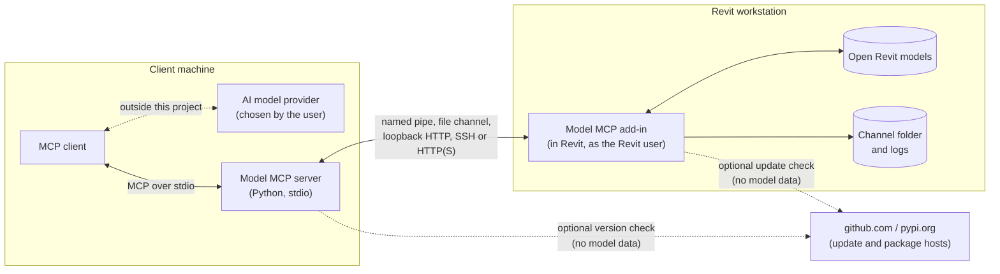

# Security whitepaper

This paper describes how Model MCP is built, what data it touches, which controls exist, and which risks remain. It is written for security reviewers. Statements describe the code of the release you install; the [questionnaire answers](security-questionnaire.md) give short answers to common review questions.

Model MCP is an open-source project (MIT). It is not a hosted service. The maintainer operates no server that receives customer data.

## Architecture

Two components work together.

| Component | Where it runs | Role |
| --- | --- | --- |
| Add-in | Inside Revit on Windows, as the Revit user | Receives requests, runs them on the Revit API thread, returns results. Opens no transaction for reads. Wraps every change in one named undo entry. |
| Server | Python process started by the MCP client, usually on the same machine | Speaks MCP to the client over stdio. Translates tool calls into add-in requests. Applies read-only mode and path redaction to outgoing responses. |

The server never calls an AI service. The MCP client the user chose receives tool results and may forward them to its own model provider. That step is outside this project.

## Trust boundaries and data flow

Trust boundaries:

1. MCP client to server: the client is trusted by the user. Whatever the client is told, it can ask for.
2. Server to add-in: protected by the transport, see below.
3. Add-in to Revit: the add-in runs with the Revit user's rights. It can do whatever that user can do in Revit.
4. Workstation to the internet: only the optional update and package requests in [Outbound network](#outbound-network).

Model data classes returned to the client depend on the tool: model and document names, file paths, element parameters, geometry summaries, warnings and exported view images. Exports can also write PDF, DWG, IFC, NWC and CSV files to disk.

## Transports and authentication

| Transport | Binding | Authentication | Notes |
| --- | --- | --- | --- |
| Named pipe | `\\.\pipe\RevitModelMcp.<pid>` | Windows ACL: only the user who runs Revit | Remote pipe clients are dropped. Requests are limited to 1 MiB. No token is needed because the same user already owns the model. |
| File channel | Per-user folder under `%LOCALAPPDATA%\RevitModelMcp` | Folder ACL for the current user; the add-in refuses a folder that others can write | Used by the local host and by SSH. |
| HTTP | Off by default. `127.0.0.1:53110` when on | 32-byte random bearer token in `settings.json` with a user-only ACL. The client verifies a nonce proof from the add-in before it sends the token. | No TLS. Redirects are refused. Requests are limited to 1 MiB. Put remote access behind a tunnel or a TLS proxy. `/health` needs no token and exposes the active document name and process information. |
| SSH | No extra port | Local OpenSSH configuration and agent | The server stores no credentials. A forced command can restrict a key, see [security](../security.md). |

Not provided: single sign-on, per-client identities, token rotation, rate limiting of failed HTTP logins, TLS termination. All HTTP callers share one token.

## Controls

### Read-only mode

Read-only mode refuses every action tool and keeps read tools. It comes from one workstation lock, set with the Read-only ribbon button or `revit_set_read_only`, or from the machine policy `ReadOnly` value that a user cannot change; the policy wins. Chat can turn the lock off only after explicit user confirmation. The user who owns the lock can remove it, so it is a safety switch and not an enforcement control. Use the machine policy for enforcement.

### Machine policy

An administrator can set read-only mode, allow and deny lists for tools, whether C# execution is available, the update mode, trusted network roots, log location and retention, path redaction and the HTTP listener. Registry values win over the policy file, and policy wins over user settings. A blocked call returns a message that starts with `Blocked by organization policy:`. See the [policy reference](policy-reference.md).

### Confirmations, dry runs and undo

- Every change is one named Revit undo entry, listed in the activity pane. `revit_undo_last` reverts the last MCP action while it is still the latest change in Revit.
- Save, synchronize, close with possible loss, link removal, overwriting exports, C# execution, in-place saves in multi-model runs and deletion of more than 500 elements need a single-use confirmation token. It expires after five minutes and is bound to the call it describes.
- Tools that change data accept `dry_run` where it makes sense.
- A central model opened through MCP is detached by default. Saving an open central model is refused.
- Confirmation tokens guard against mistakes and against instructions injected through model data or tool output. They do not stop an MCP client that confirms on its own, because the client receives the token. Use read-only mode or policy for unattended runs.

### Code execution

`revit_execute_code` compiles and runs C# with the Revit user's rights. It is not sandboxed and can read and write files and call network APIs. Controls: refused in read-only mode, token bound to the code hash, transaction mode and document, `transaction="none"` refused, source saved for audit. The machine policy can turn the tool off. Treat enabling it as granting the Revit user's rights to the MCP client.

### Network paths

UNC shares are denied by default for export, save, open, shared parameter files and NWC settings. Approved roots are allowed through `trustedNetworkRoots`. `RSN://` paths use Revit Server and are not restricted by that list.

## Outbound network

Every network call in the shipped code is in this table. The project has no telemetry, analytics, crash reporting or AI provider call. The same list is declared in the [tool manifest](../tool-manifest.md).

| Component | Destination | When | Data sent | How to turn off |
| --- | --- | --- | --- | --- |
| Add-in update check | `api.github.com` (`/repos/sharafutdinovdi/revit-model-mcp/releases/latest`) | At most every 24 hours after Revit starts | A plain HTTPS request with the user agent `RevitModelMcp updater` | `UPDATECHECK=0`, `updateCheck:false`, `REVIT_MCP_NO_UPDATE_CHECK=1`, managed bundle, `UpdateMode=off` |
| Add-in update download (per-user installs only) | `github.com` and `release-assets.githubusercontent.com` | When a newer stable release exists | A plain HTTPS request for the MSI and `SHA256SUMS.txt` | Same as above |
| Server update check | `pypi.org` | At most every 24 hours at server start | A plain HTTPS request | `REVIT_MCP_NO_UPDATE_CHECK=1` |
| Server package download | `pypi.org`, `files.pythonhosted.org` | When uv installs or refreshes the package, and at first launcher start | A plain HTTPS request | Pin the version and install from a wheelhouse |
| Install script | `api.github.com`, `github.com` | When `install.ps1` is run | A plain HTTPS request | Do not run it |
| User-configured | The HTTP(S) host in `REVIT_MCP_HOST`, an SSH host, the Revit Server REST base | Per use | MCP requests and results | Do not configure |
| Local only | Loopback `/health` self-probe | When HTTP is on | None leaves the machine | `httpEnabled=false` |

GitHub and PyPI see the network address of a request as for any web request. The add-in's Revit Server client sends the Windows user name and the machine name in request headers when a multi-model run uses Revit Server REST.
[INFERENCE] GitHub can redirect release assets to other `githubusercontent.com` hosts; allow the host family if you permit per-user updates.

## Storage and retention

| Data | Location | Retention |
| --- | --- | --- |
| Settings and HTTP token | `%LOCALAPPDATA%\RevitModelMcp\settings.json` | Until removed. Created at first start, also when HTTP is off. |
| Requests, responses, exported PNG files | Channel folder, `%LOCALAPPDATA%\RevitModelMcp` | Removed after retrieval. Read results expire after 10 minutes and action results after 24 hours. Files left by interrupted work have no age limit. |
| Activity log | Activity log file in the same folder | JSON lines, 5 MiB with one rotated copy |
| Add-in log | `Documents\RevitModelMcp\Logs`, fallback `%TEMP%\RevitModelMcp\Logs` | Rotates at 10 MiB, newest 14 files kept. This is a count, not a number of days. |
| C# audit files | `%LOCALAPPDATA%\RevitModelMcp\code` | Newest 500 files |
| Files you ask for | The path you or the client gives | Not managed by the project |

Data is stored in plain files. Use disk encryption such as BitLocker for protection at rest. The project adds no encryption of its own.
With the `LogDir`, `LogRetentionDays` and `RedactPaths` policy values an administrator can move logs, bound their age and redact paths.

## Logging and redaction

- The activity pane and activity log record each request and action with the command and client name. They do not record all arguments.
- The add-in log records jobs received, errors and lifecycle events. The HTTP token is never logged.
- Revit's undo list carries one entry named `MCP (<client>): 
` for every change.
- Path redaction (`REVIT_MCP_REDACT_PATHS=1`) shortens paths in Python responses. For add-in logs and audit files, the variable must be set in the Revit process environment, or by the `RedactPaths` policy. Model names and parameter values stay visible.
- There is no Windows Event Log or SIEM sink and no tamper protection for the files. Forward the log folders with your own agent if you need that.

## Supply chain

| Item | Status |
| --- | --- |
| Source | Public repository, release-please changelog, pull request checks, CODEOWNERS |
| CI security | CodeQL, OpenSSF Scorecard, Dependabot, GitHub Actions pinned by commit SHA, hash-pinned tooling requirements |
| Build provenance | GitHub build provenance attestations on release assets built after provenance was enabled. Verify with `gh attestation verify`, see [verify downloads](../security.md#verify-downloads). |
| Checksums | `SHA256SUMS.txt` on every release |
| Code signing | **Not in place.** Release MSI, DLL and EXE files are not Authenticode-signed. Signing through SignPath is prepared and starts after the application is approved; see [code signing](../code-signing.md). The Claude Desktop bundle has no MCPB signature. |
| SBOM | Every release attaches two CycloneDX files, `revit-model-mcp-addin-<version>.cdx.json` (NuGet dependencies) and `revit-model-mcp-python-<version>.cdx.json` (Python dependencies). Lock files exist too (NuGet lock files, `server/uv.lock`, hash-pinned requirements for the container image). |
| Dependency scanning gates | Dependabot only. No vulnerability scan blocks a release today. |
| Third-party licenses | [Third-party notices](https://github.com/sharafutdinovdi/revit-model-mcp/blob/main/THIRD-PARTY-NOTICES.md) list direct dependencies. Transitive Python dependencies are not listed. |
| Autodesk code | No Autodesk binaries are shipped; Revit API assemblies are referenced only. |

Because the binaries are unsigned, application allow-listing that needs a publisher rule (AppLocker, WDAC) has to use a path or hash rule until signing starts. The per-user updater runs from a user-writable folder, which is one reason to use the per-machine MSI.

## Vulnerability handling

Report vulnerabilities through the private advisory form or the email address in the [security policy](../security-policy.md). 0.x releases are previews: report against the latest release or main. The policy page does not promise response times or a disclosure schedule.

## Residual risks

| Risk | Why it remains | Mitigation |
| --- | --- | --- |
| An MCP client that confirms its own tokens | The client receives every token | Read-only mode or policy for unattended use |
| `revit_execute_code` | Unsandboxed C# with user rights | Turn it off by policy; review the preview |
| Prompt injection through model data | Model text reaches the AI client | Tokens, read-only mode, tool deny list |
| Plain HTTP | No TLS in the listener | Keep HTTP off, loopback only, or use a tunnel or TLS proxy |
| Shared HTTP token | One token for all callers | Per-user token, loopback bind |
| Unsigned binaries | Signing not yet in place | Verify checksums and attestation; sign with an organization certificate |
| Local files are plain text | No encryption by the project | Disk encryption, policy for log location |
| Server dependencies float at first install | `uvx` resolves from PyPI | Pin the version; install from a wheelhouse |
