# Ribbon icons

The ribbon SVG masters use a 32 × 32 viewBox and at least 2 units of edge padding.
The line icons use 2-unit strokes with round caps and joins.
Light line icons use neutral `#2B2B2B` and accent `#1F4E79`; dark line icons use neutral `#E6E6E6` and accent `#7FB2E5`.
Each line icon accents one element and uses simple geometry that remains legible at 16 px.
Both ribbon logo variants use the filled three-slab brand mark on a transparent background.
The 512 × 512 `logo-master.svg` uses the original mark and rounded navy tile composition from `bundle/icon.png`.
The assets are static and contain no animation, text elements, scripts, or external resources.

`uv run build/render_brand_assets.py --ribbon-icons` renders the ribbon PNGs with Chromium at 4× resolution and downsamples with Pillow's Lanczos filter.
Both output sizes use the 32-unit masters; the 512-unit logo master remains available for store artwork.
The build-only dependencies are declared in the renderer's script header.

| Icon | Light | Dark |
| --- | --- | --- |
| Logo |  |  |
| Connect | 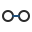 |  |
| Activity | 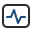 | 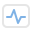 |
| Help | 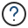 |  |
| Issue | 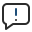 | 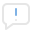 |
| Support | 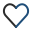 | 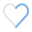 |
| About | 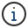 |  |
| Update | 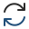 | 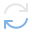 |
| Settings | 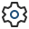 |  |
