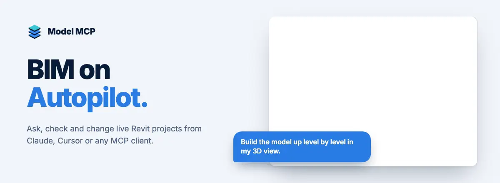

# Model MCP for Revit

Model MCP connects AI assistants to live Autodesk Revit models for queries, BIM coordination, and model edits with one named Undo entry per committed transactional change.
Supports **Revit 2022-2027 on Windows** with optional read-only mode.

## Install with an AI agent

Paste this prompt into a local installation agent:

```text
Install Model MCP for Revit from https://github.com/sharafutdinovdi/revit-model-mcp. Follow docs/agent-install.md exactly.
```

[One-command agent install](agent-install.md) includes checksum verification, client registration, and diagnostics.

## Guides

- [Connect Claude to Revit](guides/connect-claude-to-revit.md)
- [Connect ChatGPT, Codex, Cursor or VS Code to Revit](guides/connect-chatgpt-codex-cursor-vscode-to-revit.md)
- [Revit MCP servers compared](guides/revit-mcp-servers-compared.md)
- [AI model coordination in Revit](guides/ai-model-coordination-in-revit.md)
- [Build a BIM model in Revit with AI](guides/build-bim-model-in-revit-with-ai.md)
- [Is it safe? Read-only, Undo and privacy](guides/safety.md)
- [FAQ](guides/faq.md)

<picture>
  <source media="(prefers-color-scheme: dark)" srcset="assets/hero-dark.webp">
  
</picture>

[Tools](tools.md) · [Prompts](prompts.md) · [Requirements and installation](install.md) · [Latest release](https://github.com/sharafutdinovdi/revit-model-mcp/releases/latest) · [Tested clients](tested-clients.md)
