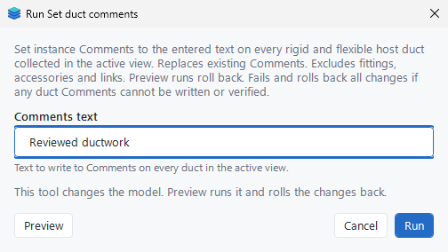
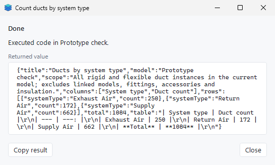
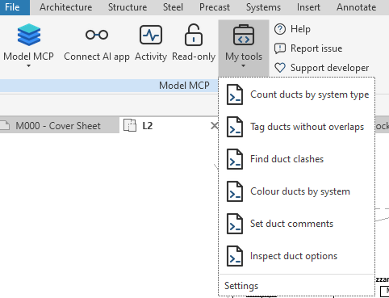
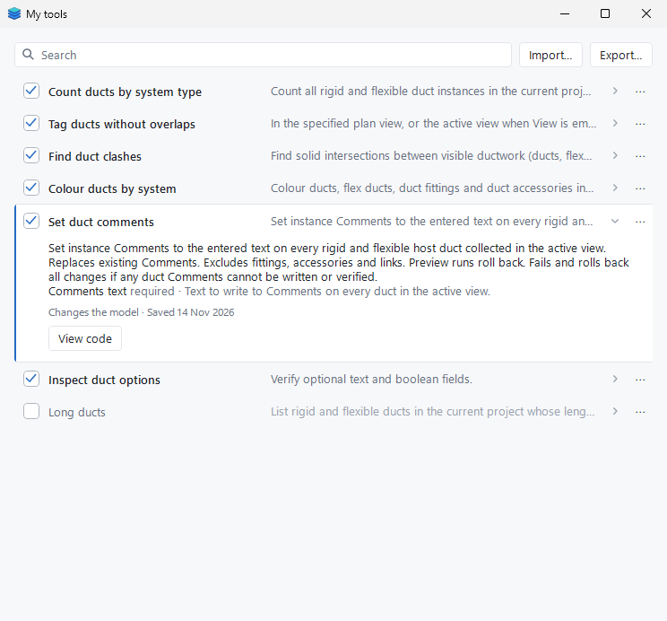
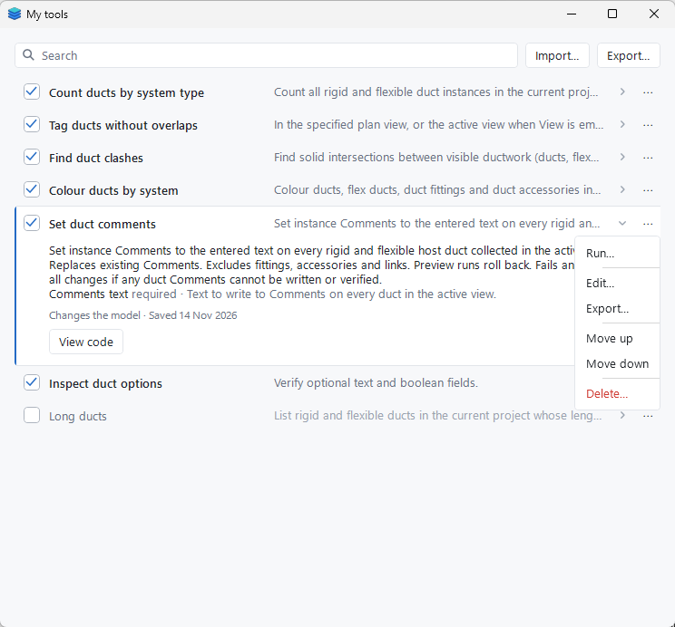
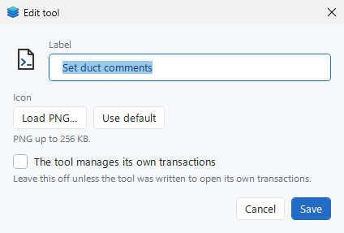
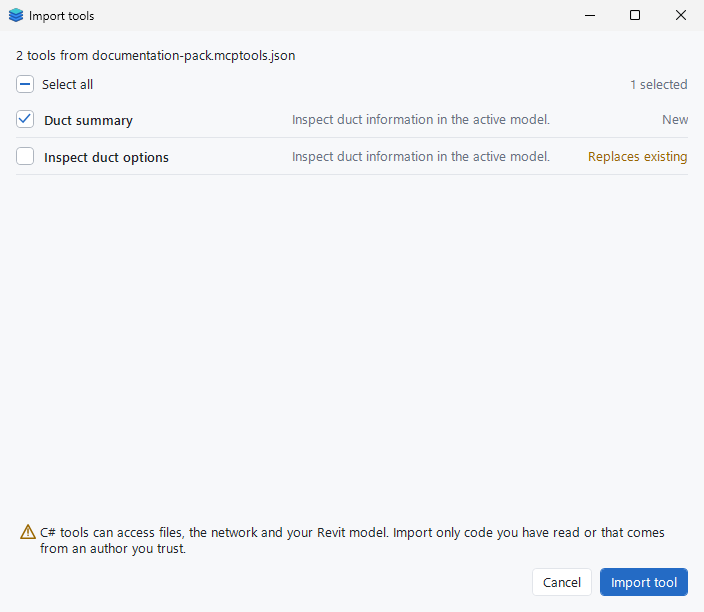

# My tools

My tools saves an approved C# procedure with parameters on the Revit workstation.
The MCP catalog stays fixed: saved procedures run through `revit_run_tool`, without dynamic tool registration.
The `code` toolset contains the saved tool commands.

## Save a procedure

After a successful multi-step or C# procedure, the agent offers once to save it as a parameterized tool.
Saving requires the user's explicit yes.
The agent chooses a name matching `^[a-z][a-z0-9_]{2,47}$`, a description, a parameter schema, and mode `read` or `action`.
The name remains the internal identifier.
An optional root `title` in the parameter schema supplies the default button label.
The optional `tested_revit_years` records years actually verified by the author, from 2022 through 2027.
An empty list claims no tested years.

`revit_save_tool` compiles the source and validates the schema without running the script.
The first call returns `data.needsConfirmation`, `data.confirmToken`, a summary, and `data.tool` with the full source and SHA-256 revision.
The agent shows the source, parameters, mode, and confirmation text to the user.
Only after explicit approval does it repeat the identical call with `confirm_token`.
Tokens are single use, expire after five minutes, and bind the tool name, source revision, description, parameter schema, mode, and tested years.
A changed definition requires a new review.

The source accepts the same method body or public static `Script.Execute(ScriptContext ctx)` compilation unit as `revit_execute_code`.
Parameters are available through `ctx.Args` as `string`, `long`, `double`, and `bool` values.

```json
{
  "name": "count_walls",
  "description": "Count walls whose name contains a supplied label.",
  "parameters": {
    "type": "object",
    "title": "Count matching walls",
    "properties": {
      "label": { "type": "string", "title": "Wall name contains", "maxLength": 100 }
    },
    "required": ["label"],
    "additionalProperties": false
  },
  "code": "var label = (string)ctx.Args[\"label\"]; return new FilteredElementCollector(ctx.Document).OfClass(typeof(Wall)).Count(wall => wall.Name.Contains(label));",
  "mode": "read",
  "tested_revit_years": []
}
```

The schema supports an object with primitive `string`, `number`, `integer`, and `boolean` properties.
Supported root keywords are `type`, `title`, `properties`, `required`, and `additionalProperties`.
Supported property keywords are `type`, `title`, `description`, `enum`, `minimum`, `maximum`, and `maxLength`.
The root type must be `object`; `additionalProperties`, when supplied, must be `false`.
Root and property titles must contain 1 to 80 characters after trimming, without control or Unicode Format characters.
Saving or importing a tool also rejects Unicode line and paragraph separators (U+2028 and U+2029) in titles.
Previously stored tools with those separators remain loadable and runnable; saving a new revision requires a single-line title.
A property `title` labels its form field; argument keys remain the property names.
Nested objects, arrays, references, patterns, defaults, and other schema keywords are rejected.
Unsupported keyword errors name the offending keywords and list the supported keywords.
MCP argument errors report the parameter name, including missing required arguments, type mismatches, and violated bounds.
The ribbon parameter form reports the field label, using its title when present.
Integer arguments must fit `Int64`.
Schemas and argument objects are limited to 64 KB UTF-8 each.
Source is limited to 256 KB UTF-8, and the active catalog holds at most 200 tools.

## Review and run

`revit_list_tools` lists names, descriptions, parameters, modes, revisions, tested years, authors, and revision dates without source.
`revit_get_tool(name)` returns the full active revision for review.
The list returns valid entries in `tools` and damaged folders in `invalid`, with a name and generic reason.
A damaged folder does not prevent listing or confirmed deletion, and cannot run.
The `parameters` field in workstation responses contains JSON schema text.

`revit_run_tool(name, args, dry_run, confirm_token)` validates arguments and verifies approval before compilation or execution.
Action mode uses the same confirmation flow as `revit_execute_code`: a first real call runs nothing and returns a token, and a confirmed retry runs the identical revision and arguments.
The first run of every name and revision hash in each Revit process requires a `confirm_token`, including read mode and dry runs.
Execution tokens bind `dry_run` as well as the code, transaction mode, tool revision, approval, and arguments.
A preview token cannot authorize a commit, and a commit token cannot authorize a preview.
A supplied token is always checked and consumed, even after the first confirmed run.
The confirmation shows the tool name, mode, short revision hash, saved timestamp, replaced revision hash when present, and validated arguments truncated to 300 characters.
After a confirmed run, read mode and dry runs require no further token for that revision in that session.
Action runs that commit changes still require confirmation for each call.
Read mode and dry runs roll back model changes.
Both modes require an open target document and use `document` for addressing.
`transaction="auto"` owns the transaction; the script must not start a Transaction.
`transaction="group"` opens no outer Transaction and permits script-owned transactions and native edit scopes.
Every script-owned scope must finish before return; errors and unfinished scopes roll back the group.
See [transaction ownership](actions.md#execute-c-code) for the shared runner and workstation validation requirements.
A committed model change has one undo entry named `Model MCP: <tool name>`, an Activity record, and a summary.
A procedure that changes nothing leaves no undo entry.
Long calls can return `status:running`; polling `revit_jobs` retrieves the original result.
A timeout or failed verification can follow a committed change.
Resubmitting can repeat that change.

The first local run of a name and revision in each Revit process opens **Review saved tool**; a changed mode, input schema or transaction setting asks for review again.
It shows the display label, tool identifier, mode, saved date, short revision, replaced revision when present, and tested Revit years.
An untested running year, including an empty tested-years list, produces a warning.
**View code** opens a read-only source viewer with metadata and **Copy code**.
**Approve and run** continues; **Cancel** stops.
Returning to a transaction setting that was already reviewed for the same revision in this Revit process does not ask again.
The ribbon review set is separate from the MCP token-confirmed set.
A local approval never waives an MCP token, and an MCP token never waives the local review.

Tools with inputs open **Run <label>**, a schema-generated form with typed controls, optional-field labels and a hint below each field.
Validation uses the same Core validator as `revit_run_tool` and identifies the field by its title or parameter name in errors.
An empty or whitespace-only text box is omitted from arguments; a required field then reports its missing field label before execution.
Optional blank text boxes and enum fields without a selection are also omitted.
The form remembers the last validated arguments for the current Windows user.
**Run** executes the tool; **Cancel** closes the form.
Action tools with inputs also offer **Preview**, which rolls back Revit model changes and displays the result.
Transaction mode comes from **Edit…** in Settings, not from a per-run choice.
Tools without inputs skip the form and use the stored transaction mode.
Action tools without inputs require **Run <label>?** confirmation before execution.
Read tools run with rollback.
Execution displays a wait cursor and a status window.
The result window shows **Done**, **Preview finished. Nothing was changed.** or **Failed**, followed by the summary.
It shows the returned value and log when present, truncated for display with **Copy result**.




## Ribbon and settings

**My tools** is a pulldown on the Model MCP panel.
Its first 24 visible approved tools have individual buttons with labels, icons, descriptions, modes, short revisions and tested years.
Buttons are ordered by presentation order, then by the MCP tool name.
Unused slots are hidden; overflow tools remain runnable in **Settings**.
The pulldown refreshes at startup, after a save or deletion through MCP in this process, and after Settings closes.
Each refresh reads the shared per-user store, including changes made by another Revit process.
**Settings** remains available without a document; tool buttons require an active document.



**Settings** shows one list of every saved tool.
The top bar contains search, **Import…** and **Export…**.
Search matches the tool identifier, label or description.
A ticked checkbox puts the tool on the ribbon.
When all 24 slots are occupied, the other checkboxes are disabled until a tool is unticked.
Unticked tools are greyed and remain available to AI apps and **Run…**.
Ribbon tools appear first in ribbon order.
Other valid tools follow by label; invalid tools appear last with a reason.
A click on a row expands its description, inputs, read or action mode, saved date and **View code**.
**View code** opens a read-only source viewer with metadata and **Copy code**.



The **⋯** button or a right click opens **Run…**, **Edit…**, **Export…** and **Delete…**.
Ribbon tools also have **Move up** and **Move down**.
**Edit…** opens **Edit tool** with a label of 1 to 80 characters, **Load PNG…**, **Use default** and **The tool manages its own transactions**.
The label overrides the schema root title; the MCP name remains the identifier.
The transaction checkbox stores `group` when ticked and `auto` otherwise.
The default transaction mode is `auto`.
Icons use the default script icon or an imported, single-frame PNG of at most 256 KB and 1024 pixels per dimension.
Imported icons are resized into 16 px and 32 px copies.
Stored and imported PNG dimensions are checked before full pixel decoding.




`Ctrl+F` focuses search; `Esc` clears a nonempty search.
On a focused row, `F2` opens **Edit tool**, `Delete` requests deletion, `Alt+Up` and `Alt+Down` move ribbon tools, and the menu key opens actions.
The read-only lock disables changes to presentation, import, deletion and execution.
Policy refusals disable the corresponding import, export, source-view, run and delete controls.
Disabled controls carry the refusal as a tooltip.
Invalid tools cannot run or be edited or exported, but allow confirmed deletion.
**Delete…** requires confirmation.
The windows have no animation.
An empty list explains how to save or import the first tool.
Load errors appear in the window.

`revit_delete_tool(name)` returns a confirmation challenge.
A confirmed repeat deletes the tool and all its revisions.
Deletion cannot be undone in Revit.


## Share a tool

**Export…** in the Settings top bar lists every valid tool with checkboxes and **Select all**.
All tools are selected by default.
**Export…** in a tool's actions opens the same list with only that tool selected.
One selected tool is written to `<name>.mcptool.json`.
Two or more selected tools are written to one `.mcptools.json` pack, with the default filename `model-mcp-tools.mcptools.json`.
Export follows `get-tool` policy and remains available under the workstation read-only lock.
The export warning lists possible file paths, web addresses, email addresses, local user or computer names, and open model or project names embedded in the tool text.
The scan is a heuristic, not a privacy guarantee; the author still reads the label, description, parameters and source before sharing.
An unfinished scan is reported explicitly; export still requires confirmation when the scan cannot finish.
Cancel is the default when the warning appears.

**Import…** accepts several single-tool files and packs at once, even with an empty list or no open document.
Import follows `save-tool` policy and the workstation read-only lock.
Before anything is saved, the review lists each tool with a checkbox and a state:

| State | Selection |
| --- | --- |
| **New** | Ticked by default |
| **Replaces existing** | Unticked by default; selecting it displays a replacement warning |
| **Already installed** | Cannot be selected |
| **Cannot import** | Cannot be selected; the expanded row gives the reason |

Expanding a valid row shows the editable tool name, metadata, full source, inputs and fingerprint.
A name collision replaces the active revision; changing the tool name imports a separate tool.
Identical exported content is **Already installed**.
**Select all** selects eligible tools, including replacements.
If the installed revision changes during review, import refuses that tool's save.
Compilation happens only after the user confirms import, without executing the source.
Import saves the ticked tools individually as new local saves.
Stopping import leaves completed saves in place; a failed entry does not undo other imports.
Import signs each save with the importing Windows user's local approval key.
Replacement preserves existing visibility, order and remembered arguments.
New tools appear at the end of the ribbon if a slot is free; otherwise, they remain unticked.
Approval data is not transferred.
The first local run of an unreviewed name and revision still requires review, and the first MCP run still requires its independent confirmation token.
Imported C# retains the Windows user's file, network and Revit API rights.
Import only code that has been read or comes from a trusted author.



The version 1 file is one flat UTF-8 JSON object without a BOM.
Import tolerates a leading UTF-8 BOM and files up to 4 MB.
Each tool inside a pack has the same 4 MB limit.
A pack is a UTF-8 JSON object with `format` set to `revit-model-mcp/tool-pack`, `formatVersion` set to `1`, and a `tools` array of single-tool objects.
Packs contain 1 to 100 tools and at most 16 MB.

| Member | Type | Content |
| --- | --- | --- |
| `format` | string | `revit-model-mcp/tool` |
| `formatVersion` | number | `1` |
| `name` | string | Tool identifier |
| `label` | string | Display label |
| `description` | string | Tool description |
| `mode` | string | `read` or `action` |
| `testedRevitYears` | array of numbers | Distinct ascending years |
| `transaction` | string | `auto` or `group` |
| `parameters` | string | JSON schema text |
| `code` | string | Normalized source |
| `icon16` | string | Base64 16x16 PNG or empty |
| `icon32` | string | Base64 32x32 PNG or empty |
| `fingerprint` | string | Lowercase SHA-256 of canonical exported values |

Both icons are present or both are empty; stored PNG headers are checked before pixel decoding.
Single-tool files and packs never contain remembered arguments, hidden flags, presentation order, author, creation dates, revision history, approval signatures or the approval key.
Hard-coded private data in exported text is still part of the file.
The fingerprint checks integrity and permits comparison between people; it is not a signature and does not authenticate the author.
Its canonical payload contains every other member in ordinal alphabetical order with deterministic JSON escaping and no whitespace.
File whitespace, escaping, BOM and line endings do not affect that fingerprint.

## Storage and security

Revisions live under `%LOCALAPPDATA%\RevitModelMcp\tools\<name>\<revision>.json` for the current Windows user.
The `active` file selects one revision.
Writes use temporary files, flush to disk, and atomically replace each destination.
A store lock serializes saves and deletions across Revit processes.
Each tool retains at most 20 revisions.
Saves delete the oldest non-active revisions above that limit.
Lock acquisition retries for up to two seconds and then reports `My tools store is busy` without a path.
The revision hash covers source normalized to LF line endings with outer whitespace removed and one final newline.
Approval also covers metadata and schema with a store-local HMAC signature.
A changed source, signature, schema, mode, or pointer causes `revision not approved` at run time.
Copying revision files from another store does not approve them; use Settings import with source review or the MCP save confirmation flow.
The local approval key remains in the per-user tools directory.

Presentation lives separately under `%LOCALAPPDATA%\RevitModelMcp\tool-presentation\<name>.json`.
It contains the display label, resized PNG copies, hidden flag, sort order, transaction mode and last arguments.
The default label uses the schema root `title` when present; otherwise, it replaces underscores in the internal name with spaces and capitalizes the first letter.
An existing presentation label takes precedence over the root title.
Saving a presentation change, such as visibility or order, preserves the current label.
Presentation never changes an approved revision, its hash or its signature.
Missing or corrupt presentation files use defaults and do not damage the approved catalog.
Deleting a tool also attempts to delete its presentation file.
A missing presentation file or folder is harmless; a locked or read-only file leaves a neutral cleanup note without changing the successful tool-deletion result.
The ribbon refreshes after deletion even when presentation cleanup cannot finish.
Labels and last used arguments are stored unencrypted in the Windows user's profile.
Secrets do not belong in tool arguments or display labels.
Shared-file import accepts single-tool files up to 4 MB and packs of at most 100 tools and 16 MB.

Saved C# has full Revit API access and the Windows user's file and network rights.
Neither read mode nor dry run is a sandbox for file or network operations.
The approval files defend against accidental edits and unapproved imports, not an attacker who controls the Windows account and its approval key.
The workstation read-only lock blocks saving, deleting, and running tools, including read-mode and dry-run execution, just as it blocks `revit_execute_code` with `dry_run=true`.
List and review remain available while locked.
All saved tool commands inherit `ExecuteCode`, channel defaults, and restrictions on `execute-code` in addition to their own tool policies.
An administrator's policy cannot be lifted through chat or ribbon.
Response path redaction preserves tool source, parameters, and description in save and get previews.
Model paths elsewhere in responses remain redacted.
Tool run audit lines record name, revision, source (`ribbon` or `mcp`) and argument names without argument values.
Validation rejects Unicode Format characters in source, names, descriptions, and parameter names.
Saved source itself remains local user data and must not contain credentials.

## My tools threat model

Approval protects against silent tool replacement between sessions by requiring a first-run confirmation in every Revit session.
The confirmed set exists only in Revit process memory, keyed by tool name and revision hash.
Saving a revision with a valid HMAC does not add it to that set.
The approval key is readable by code executing as the Windows user.
Approval does not protect against a client that can already execute code in the current session.
`execute_code` dry-run semantics remain unchanged; rollback covers Revit model changes and does not sandbox file or network access.
Internal `ToolStore` and `ToolDefinition` types prevent direct script calls through the Core assembly surface as defense in depth, not as a security guarantee.
My tools use the same machine policy, workstation read-only lock, transport authentication, and execution gates as `execute_code`.
Import review is the only barrier against a hostile shared file.
The fingerprint does not authenticate its source or limit the imported code's rights.

A click in Revit is a local human action, not an MCP token exchange.
It enters the same `run-tool` execution pipeline with approval/HMAC, active revision, argument validation, machine policy, store-channel rules, workstation lock, transaction ownership, named Undo and Activity gates.
The revision is checked again after the local dialogs; replacing it during review refuses execution.
The first-run review protects against unnoticed revision changes and untested Revit years.
It does not prove that the source is safe or limit its capabilities.
Saved C# retains full Revit API access and the Windows user's file, network and process rights.

## Verification

Core tests cover normalized hashes, argument validation, approval binding, tamper refusal, persistence, atomic file cleanup, catalog limits, presentation defaults and corruption, slot assignment, form validation, independent session confirmations, refusal mapping, cross-store sharing, canonical fingerprints, malformed share refusals and private-data scan limits.
Python tests cover schemas, confirmation forwarding, annotations, and policy refusals.
Run the following workstation checklist in Revit 2022 and 2026 at minimum; other supported years also require workstation verification.

1. Check all 24 slot commands, hidden and overflow tools, zero-document Settings, and refresh after MCP save/delete, Settings close and changes in another Revit process.
2. Check first-use revision review, tested-year warnings, independent MCP tokens and ribbon review, and confirmation of every action run.
3. Check typed fields, named validation errors, remembered arguments, Preview rollback, and stored `auto`/`group` modes both with and without a parameter form.
4. Check workstation lock, `ExecuteCode=off`, `ToolDeny` for `run-tool`, ToolAllow and the store-channel administrator rule on both paths.
5. Check label editing, Move up/down, ribbon checkboxes, default and custom icons, oversized or corrupt stored/imported PNG rejection before pixel decoding, keyboard order, both themes and no animation.
6. Delete through MCP and Settings without prior presentation data, then with locked or read-only presentation data; verify successful deletion, a neutral note without local paths, and immediate ribbon refresh.
7. Check named Activity rows, one named Undo entry, audit source without argument values, result copying and truncation, and wait feedback during long execution.
8. Export under one Revit year and Windows user, then import under another year and user; check source, parameters, icons and local approval.
9. Check identical-content import, name collision replacement, rename during import, and refusal when the installed revision changes during review.
10. Check locked import refusal, locked export, `save-tool` and `get-tool` policy refusals, broken or oversized files, and invalid icons.
11. Check the untested-year warning, compile errors after Import, cancellation without compilation, and independent first-run local review and MCP confirmation after import.

## Queued requests after local dialogs

MCP requests can remain queued while a modal Revit command is open.
Pending requests also use Revit's Idling API context after the command returns.
The same execution guard services native ExternalEvent callbacks and idle recovery; a delayed callback cannot replay an already serviced request.
An exception while raising a native wake-up does not discard the pending request.

To verify recovery in Revit 2022 and 2026:

1. Start a fresh session and confirm that MCP ping and list-tools complete.
2. Open My tools Settings, then **Edit…**, and submit an MCP ping while **Edit tool** remains open.
3. Close **Edit tool** and Settings; verify that the queued ping completes once after Revit becomes idle, then submit another ping and list-tools.
4. Repeat with an overflow tool run from Settings, label editing, **Use default**, valid PNG, rejected PNG imports, **View code** and keyboard navigation before closing the dialogs.
5. Compare with the earlier build using the same sequence and inspect request completion and Activity; a fresh heartbeat alone is not proof of working dispatch.

## Approval across Revit versions

Approval belongs to the Windows user's store, not to an individual Revit year or .NET runtime.
All installed Revit versions need an add-in containing the cross-runtime approval fix.
The HMAC uses the UTF-8 text stored in the revision file without reserializing the parsed definition.
New saves use fixed member order, deterministic string escaping and invariant number formatting.
The source revision hash and the existing store-local approval key are unchanged.
Unmodified legacy revision files and their signatures remain valid, including files written with either .NET Framework control-character escape policy.
Editing or reformatting a signed revision file requires source review and approval again; restoring the original signed file also restores its approval.

Core tests pin the canonical UTF-8 payload hash, HMAC and confirmation binding to fixed vectors and exercise both legacy escaping policies.
These tests execute on modern .NET.
Workstation verification must save and approve a tool with multiline source and non-ASCII metadata in Revit 2026, list and run it in Revit 2022, then repeat in the reverse direction without changing the shared key or approving again.
